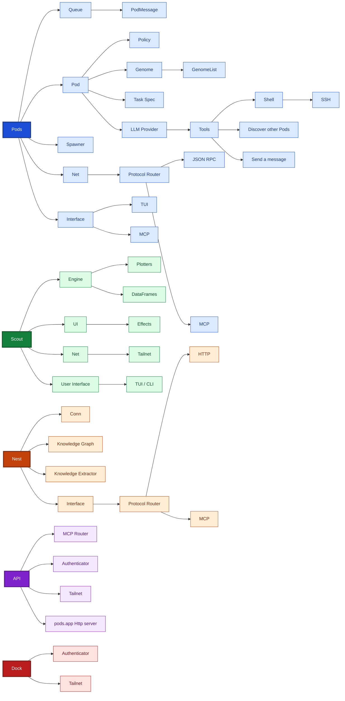

# Hive

A self-evolving agent swarm built in Rust. Hive is an experimental multi-crate workspace exploring computational agent loops, Cartesian Genetic Programming (CGP) for pod behavior, and terminal-based orchestration UIs.

## Architecture

Hive is organized as a Cargo workspace with four crates:

| Crate | Purpose | Status |
|-------|---------|--------|
| `pods` | Core hive runtime, TUI dashboard, actor-based pod system, CGP genome engine | Active development |
| `scout` | Notebook-style TUI for data exploration (Polars, Rhai scripting, plotting) | Active development |
| `nest` | Placeholder binary (reserved for future hive node / worker process) | Skeleton |
| `swarm` | Placeholder library for learning, logic, modeling, optimization, and search modules | Skeleton |





## Workspace Structure

```
hive/
├── Cargo.toml          # Workspace manifest (members: nest, pods, scout, swarm)
├── pods/
│   ├── Cargo.toml      # Package name: "pods", lib name: "hive", bin name: "hive"
│   └── src/
│       ├── main.rs          # TUI entrypoint — boots terminal and runs hive
│       ├── lib.rs             # Library exports: core, knowledge, link, pods, tui
│       ├── core/mod.rs        # Hive runtime: command/event loop, actix actor system
│       ├── knowledge/mod.rs   # Stubbed knowledge base with embedding/retrieval traits
│       ├── link/mod.rs        # Inter-pod messaging: PodMessage, PodResponse, PodConfig
│       ├── pods/
│       │   ├── mod.rs         # Built-in pod re-exports
│       │   ├── genome/mod.rs  # Cartesian Genetic Programming genome (Node, Genome, mutation)
│       │   ├── ping/mod.rs    # Simple Ping actor for testing actix message passing
│       │   ├── pod/mod.rs     # Pod actor: wraps a CGP Genome, handles queries
│       │   └── speaker/mod.rs # LLM speaker actor via rig + Ollama (currently unused)
│       └── tui/
│           ├── mod.rs         # Event loop (~60 FPS), keyboard input dispatch
│           ├── input.rs       # Keymap: Ctrl+P (ping), Enter (submit), Ctrl+S (spawn mode)
│           └── ui/mod.rs      # ratatui rendering: agent panel, hive graph, activity log
├── scout/
│   └── src/
│       ├── main.rs            # Notebook TUI entrypoint with vim keybindings
│       ├── app/               # Cell management, viewport, notebook state
│       ├── engine/            # Script execution, plotting, Polars integration
│       ├── ui/                # ratatui rendering and visual effects
│       └── util/              # Vim-mode input handling
├── nest/
│   └── src/main.rs            # "Hello, world!" placeholder
└── swarm/
    └── src/
        ├── lib.rs             # Placeholder add function
        ├── learning.rs        # Reserved
        ├── logic.rs           # Reserved
        ├── modeling.rs        # Reserved
        ├── optimization.rs    # Reserved
        └── search.rs          # Reserved
```

## Running

### Pods (Hive Runtime + TUI)

```bash
cd pods
cargo run --bin hive
```

**TUI Controls:**
- `Ctrl+P` — Send ping to the hive actor system
- `Enter` — Submit text from the input bar
- `Ctrl+S` — Toggle spawn overlay (prepares to spawn a new pod)
- `q` / `Ctrl+C` — Quit

### Scout (Notebook TUI)

```bash
cd scout
cargo run --bin spool [notebook.md]
```

**Vim-style controls:**
- `j/k` or `↓/↑` — Navigate cells
- `Enter` — Focus/unfocus cell editor
- `Tab` — Run cell and show output
- `a` — Add new cell
- `d` — Delete cell
- `o` — Toggle output panel
- `q` — Save and quit

## Key Concepts

### Pods
Pods are actix actors that participate in the hive runtime. Each pod carries a **Cartesian Genetic Programming (CGP) genome** that defines its behavior graph. Genomes are composed of:
- **Nodes** (`func` + backward-only input connections)
- **Output pointers** (value-table indices)
- **Mutation** (random function / connection flips)

### Hive Loop
The hive runs an async event loop inside an actix system on a background thread. It receives commands (`Ping`, `Submit`, `SpawnPod`) via channels and broadcasts responses to TUI subscribers.

### Knowledge Base (Stubbed)
A trait-based design for per-type embedding spaces, retrieval, and feedback loops. Currently unimplemented but provides the structural surface for future RAG-style memory.

## Dependencies

- **actix** — Actor framework for pod lifecycle
- **tokio** — Async runtime
- **ratatui** + **crossterm** — Terminal UI
- **rig-core** — LLM client abstraction (Ollama support)
- **Polars** — Data frames (scout)
- **Rhai** — Embedded scripting (scout)
- **petgraph** — Graph structures (scout)

## Status

This is an active research project. Many components are skeletal or stubbed (`todo!()`). The pods crate has the most mature runtime, while scout provides a separate notebook interface for data workflows.

